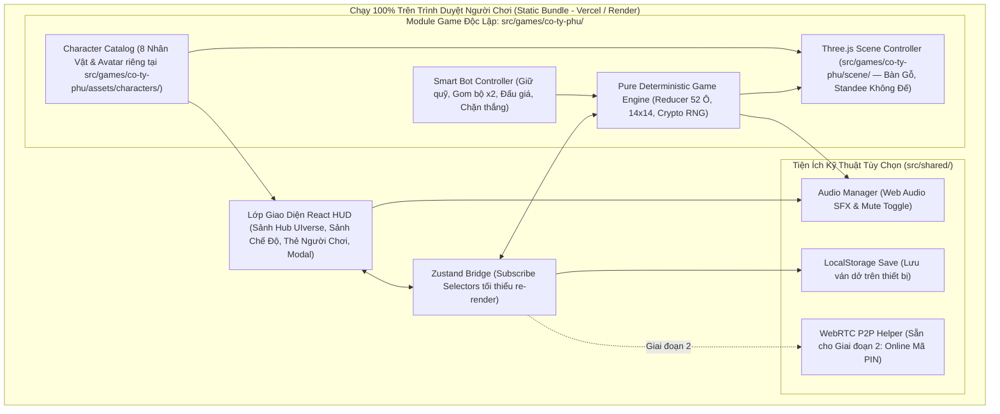
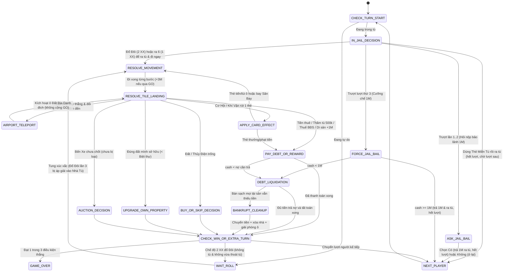
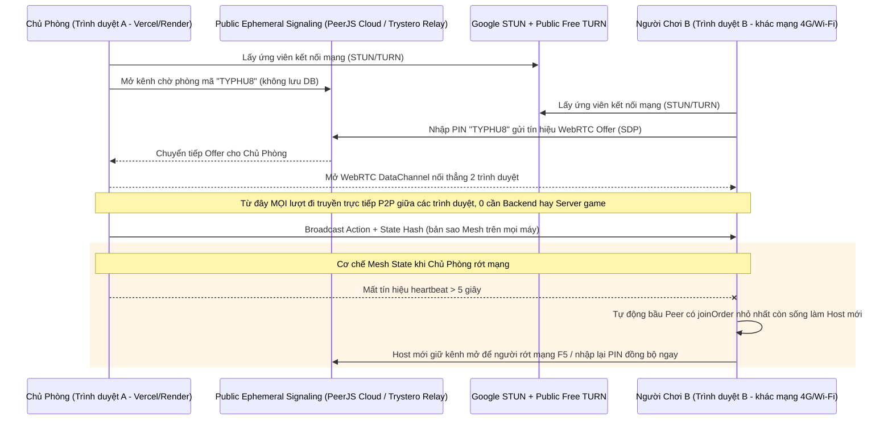

# 🏗️ KIẾN TRÚC HỆ THỐNG, CÔNG NGHỆ & ĐỒ HỌA 3D (100% PURE FRONTEND)

> **Tài liệu số 02** — Kế thừa toàn bộ luật chơi và dữ liệu chuẩn từ [01_GAME_CO_TY_PHU.md](./01_GAME_CO_TY_PHU.md)  
> **Phong cách giao diện đã chốt**: Phong cách 1 — *Bàn Gỗ Nắng Ấm & Kem Xanh Ngà 3D* ([web_board_3d_enlarged.png](./mockups/web_board_3d_enlarged.png))  
> **Mô hình triển khai**: **100% Thuần Frontend Static SPA** (Không Backend, Không Database — Deploy 1 click lên **Vercel**, **Render Static Site**, Cloudflare Pages)

---

## I. TỔNG QUAN CÔNG NGHỆ & STACK THUẦN FRONTEND

Để đảm bảo bạn **chỉ cần build 100% Frontend**, chạy mượt **60fps** trên PC/Tablet/Mobile và đưa thẳng lên **Vercel hoặc Render (Static Site)** mà **không cần viết Backend API, không cần thuê Server hay cài đặt Database**, toàn bộ hệ thống chạy hoàn toàn trên trình duyệt (*Browser-only*):

| Lớp Kiến Trúc | Công Nghệ Đề Xuất | Lý Do Lựa Chọn (100% Static Frontend) |
| :--- | :--- | :--- |
| **Build & Framework Web** | **Vite + React + TypeScript** *(hoặc Next.js Static Export)* | Đóng gói thành bộ file tĩnh thuần (`HTML/CSS/JS` trong `dist/`), tốc độ khởi chạy tức thì, deploy miễn phí không lo Server "ngủ đông" (cold-start) trên Render hay Vercel. |
| **Quản Lý State & Logic Game** | **Pure TypeScript State Machine (FSM) + Zustand** | Toàn bộ luật 52 ô (`14×14`) viết bằng hàm thuần *(pure reducer)* chạy ngay trên trình duyệt, mọi người chơi tính ra cùng một trạng thái duy nhất mà không cần server xử lý. |
| **Đồ Họa Bàn Cờ 3D** | **Three.js (Module độc lập) + CanvasTexture Hi-DPI** | Tách khỏi chu kỳ render của React để xúc xắc, nhân vật nhảy ô và xoay camera luôn mượt 60fps; tạo texture động sắc nét cho 52 ô đất, Sân Bay, giá Đấu giá ngay trên client. |
| **UI & HUD Nổi** | **Tailwind CSS v4 + Lucide Icons** | Lớp HUD thẻ nổi bám 4 góc màn hình (desktop) và thanh dock gọn đáy (mobile), không che khuất phần bàn cờ 3D. |
| **Kết Nối Online (Không Backend/DB)** | **WebRTC P2P thuần Client (`PeerJS` / `Trystero`) + Public STUN/TURN** | Dùng hạ tầng Signaling miễn phí sẵn có (PeerJS Cloud / Public MQTT-Nostr Relay) để hai máy bắt tay trong ~1 giây, sau đó truyền dữ liệu trực tiếp P2P giữa các trình duyệt, 0 cần backend riêng. |
| **Lưu Trữ Offline (Không DB)** | **`localStorage`** *(+ `sessionStorage` cho GĐ2)* | Chỉ lưu ván chơi offline (tự động giữ kể cả F5 hay tắt máy qua hôm sau); chế độ Online sau này không lưu qua ngày. |
| **Âm Thanh & Phản Hồi** | **Web Audio API (Procedural SFX)** | Tạo âm thanh lắc xúc xắc, bước nhảy, chuông đấu giá, còi máy bay bằng code Audio thuần — không cần gọi API hay tải nặng. |

---

## II. KIẾN TRÚC TỔNG THỂ BOARD GAME WEB HUB (BROWSER-ONLY)

Nhằm phục vụ mục tiêu **Board Game Web Hub** (mỗi game tự chủ 100% trong thư mục riêng, dùng chung duy nhất **Sảnh Chọn Game ngoài cùng `src/hub/`** theo [03_CAU_TRUC_THU_MUC_VA_MO_RONG.md](./03_CAU_TRUC_THU_MUC_VA_MO_RONG.md)), mã nguồn chia lớp gọn nhẹ ngay trong dự án Frontend:



### Nguyên tắc tách lớp bắt buộc
1. **`GameEngine` không được import `three` hay `react`**: Có thể chạy unit test 100% logic luật chơi (phá sản, đấu giá bù chênh lệch, khóa cọc, nhà tù 3 lượt, 3 điều kiện thắng) ngay bằng lệnh CLI trong vài mili-giây.
2. **`Three.js SceneController` chỉ lắng nghe Event Queue**: Mỗi Action hợp lệ phát ra chuỗi `AnimationEvent` tuần tự (`DICE_ROLLED` → `PAWN_HOP` → `AIRPORT_FLY` → `HOUSE_BUILT` → `JAIL_LOCK`), giúp phần hình ảnh diễn hoạt từng nhịp trong khi dữ liệu logic đã chuẩn xác ngay tức thì.

---

## III. MÔ HÌNH DỮ LIỆU & MÁY TRẠNG THÁI (FINITE STATE MACHINE)

### 1. Cấu trúc Bàn Cờ 52 Ô Chuẩn Lưới `14 × 14`

Chỉ số `index` chạy từ `0` đến `51` ngược hoặc thuận chiều kim đồng hồ bắt đầu từ **Ô Khởi Hành (`index = 0`)**, trong đó **4 ô góc** cố định tại `0, 13, 26, 39`:

- `0`: **Ô Khởi Hành** (Corner — nhận `+3.000.000 đ` **chỉ khi đi ngang qua**, dừng đúng chân = `0 đ`).
- `13`: **Ô Nhà Tù / Thăm Nuôi** (Corner — tự do ghé thăm tốn `500.000 đ`; người đang bị giam giữ tối đa 3 lượt tại đây).
- `26`: **Ô Bãi Đỗ Xe / Trạm Nghỉ Chân** (Corner — miễn phí, an toàn).
- `39`: **Ô Bị Bắt Vào Tù** (Corner — áp giải ngay tới `index = 13`, không qua `0`, kết thúc lượt).

#### Cấu trúc TypeScript cốt lõi (Khớp 100% File 01)

```ts
export type TileKind =
  | 'GO' | 'VISIT_JAIL' | 'FREE_PARKING' | 'GO_TO_JAIL'
  | 'PROPERTY' | 'AUCTION_STATION' | 'AIRPORT'
  | 'UTILITY' | 'CHANCE' | 'FATE' | 'TAX' | 'HERITAGE';

export type EdgeIndex = 0 | 1 | 2 | 3; // 0: Dưới(1..12), 1: Trái(14..25), 2: Trên(27..38), 3: Phải(40..51)

export interface BoardTile {
  index: number;          // 0..51
  edge: EdgeIndex | null; // null với 4 ô góc
  gridPos: { col: number; row: number }; // Tọa độ 0..13 trên vành lưới 14x14
  kind: TileKind;
  name: string;
  // Riêng PROPERTY (30 ô / 10 nhóm màu x 3 ô):
  colorGroup?: number;    // 0..9
  basePrice?: number;     // 1_000_000 .. 8_000_000
  ownerId?: string | null;
  buildingLevel?: 0 | 1 | 2 | 3 | 4 | 5; // 0: Đất trống, 1..4: Nhà cấp 1..4, 5: Biệt thự
  // Riêng AUCTION_STATION (4 Bến Xe):
  auctionState?: AuctionTileState;
  // Riêng AIRPORT (2 Sân Bay):
  currentDestinationTileIndex?: number; // Luôn thuộc 1 trong 30 ô PROPERTY
}

export interface AuctionTileState {
  status: 'UNOPENED' | 'ACTIVE' | 'CLOSED';
  currentBid: number;                    // 0 (chưa mở) hoặc >= 2_000_000
  leaderId: string | null;               // Người giữ giá cao nhất hiện tại
  deposits: Record<string, number>;      // Tiền cọc đang bị khóa cứng từng người tại ô này
  eliminatedPlayerIds: string[];         // Đã bấm Bỏ quyền hoặc không đủ tiền bù chênh lệch
  finalOwnerId: string | null;
  finalPrice: number;                    // Giá chốt dùng tính tiền thuê = finalPrice / 2
}
```

> **Thuật toán Bản Đồ Ngẫu Nhiên (`Procedural Random Map`)**: Trước khi phát ván mới, hạt giống `mapSeed` **giữ nguyên tuyệt đối vị trí cố định của 22 ô khung đặc biệt** *(4 Ô Góc, 4 Bến Xe Đấu Giá `5,18,31,44`, 2 Sân Bay `7,33`, 2 Thủy Điện `20,46`, 4 Cơ Hội `3,22,29,48`, 4 Khí Vận `10,16,36,42`, Di Sản Quốc Gia `24`, Thuế BĐS `50`)* và **chỉ xáo trộn vị trí 30 Ô Đất Địa Danh (`PROPERTY`)** trong `30` slot đất đó *(kèm tránh đặt 2 ô giá vàng `≥ 7M` cạnh nhau)*, đảm bảo bàn cờ vẫn quen mắt và **mỗi cạnh luôn có đúng `9` ô mua được** cho luật *Thắng 1 Đường Thẳng*.

### 2. Quản Lý Tài Chính, Nợ & Trạng Thái Người Chơi

```ts
export interface PlayerState {
  id: string;
  order: number;
  name: string;
  characterId: CharacterId; // 'ca_phe' | 'khan_ran' | 'phuot_thu' | ...
  isBot: boolean;
  isConnected: boolean;
  isBankrupt: boolean;
  cash: number;             // Vốn khởi điểm 25_000_000
  position: number;         // 0..51
  inJail: boolean;
  jailTurnsUsed: number;    // 0..3
  consecutiveDoubles: number; // >= 3 ở chế độ 2 xúc xắc => vào tù ngay
  getOutOfJailCards: number;  // Thẻ miễn vào tù (không chuyển nhượng/trao đổi)
  lastDiceRollTotal: number;  // Dùng tính tiền thuê Ô Tiện Ích
}
```

#### Quy tắc Khóa Cọc & Bán Tài Sản Trả Nợ (Strict Guards)
1. **Tiền đặt cọc trong `auctionState.deposits[playerId]` bị khóa cứng**: Người chơi không được cộng khoản này vào `cash` khả dụng khi đi trả tiền thuê ở ô khác, không được rút cọc ngang chừng. Chỉ giải ngân khi: (a) chính người đó dẫm lại Bến Xe đang đấu giá và chọn **Bỏ quyền / Bị loại** → hoàn 100% cọc về `cash`; hoặc (b) chính thức **Phá sản** → gộp toàn bộ cọc các ô vào tài sản thanh toán chủ nợ.
2. **Không bao giờ bán tài sản khi `cash >= debtRequired`**: Giao diện nút bán nhà/đất chỉ kích hoạt trong `PHASE_DEBT_LIQUIDATION`.
3. **Thứ tự bán hợp lệ**: Phải hạ `buildingLevel` về `0` (*bán từng cấp thu 50% phí xây*) trước khi được phép bán đứt ô đất (*thu 50% `basePrice`* hoặc *50% `finalPrice` Đấu giá* hoặc *1.000.000 đ Thủy điện*).

### 3. Máy Trạng Thái Luồng Lượt Chơi (Turn FSM)



> **Lưu ý logic quan trọng từ File 01**:
> - **Phong tỏa tài sản khi chủ đất ở tù**: Trước khi tính phí thuê tại `PAY_DEBT_OR_REWARD`, luôn kiểm tra `!owner.inJail`. Nếu `owner.inJail === true` → hiển thị thông báo *"Chủ đất đang bị giam giữ — Tài sản bị phong tỏa, miễn phí thuê!"* và chuyển thẳng sang `CHECK_WIN_OR_EXTRA_TURN`.
> - **Kiểm tra 3 điều kiện thắng ngay lập tức** sau bất kỳ biến động sở hữu hoặc phá sản nào:
>   1. **Line Victory**: Có cạnh `edge ∈ {0,1,2,3}` nào mà cả `9` ô mua được đều cùng `ownerId` không? (Với Bến Xe trên cạnh đó, phải ở trạng thái `auctionState.status === 'CLOSED'`).
>   2. **4-Auction Victory**: Có người chơi nào là `finalOwnerId` của cả `4` Bến Xe không?
>   3. **Last Man Standing**: `alivePlayers.length === 1`.

---

## IV. CHIẾN LƯỢC NHÂN VẬT 3D KHÔNG ĐẾ & TÀI NGUYÊN CÓ SẴN

Từ bộ sheet thiết kế bạn cung cấp, hệ thống đã tách nền sạch, căn chỉnh baseline đôi giày chuẩn tại đáy (`y = 496/512`) và đưa vào trực tiếp bên trong thư mục mã nguồn game `src/games/co-ty-phu/assets/characters/`:

| STT | Mã Nhân Vật | Mô Hình Đứng Trên Ô (`360×512` Transparent) | Avatar Thẻ HUD (`256×256` Bust) | Ghi Chú Hiển Thị |
| :-: | :--- | :--- | :--- | :--- |
| 01 | **Cà Phê Phin** | `src/games/co-ty-phu/assets/characters/char_01_ca_phe.png` | `src/games/co-ty-phu/assets/characters/avatars/char_01_ca_phe.png` | Đế phẳng = 0 (đứng trực tiếp) |
| 02 | **Khăn Rằn** | `src/games/co-ty-phu/assets/characters/char_02_khan_ran.png` | `src/games/co-ty-phu/assets/characters/avatars/char_02_khan_ran.png` | Đế phẳng = 0 |
| 03 | **Phượt Thủ** | `src/games/co-ty-phu/assets/characters/char_03_phuot_thu.png` | `src/games/co-ty-phu/assets/characters/avatars/char_03_phuot_thu.png` | Đế phẳng = 0 |
| 04 | **Trí Thức Trẻ** | `src/games/co-ty-phu/assets/characters/char_04_tri_thuc.png` | `src/games/co-ty-phu/assets/characters/avatars/char_04_tri_thuc.png` | Đế phẳng = 0 |
| 05 | **Áo Dài Tím** | `src/games/co-ty-phu/assets/characters/char_05_ao_dai_tim.png` | `src/games/co-ty-phu/assets/characters/avatars/char_05_ao_dai_tim.png` | Đế phẳng = 0 |
| 06 | **Áo Bà Ba Nón Lá** | `src/games/co-ty-phu/assets/characters/char_06_non_la.png` | `src/games/co-ty-phu/assets/characters/avatars/char_06_non_la.png` | Đế phẳng = 0 |
| 07 | **Nữ Doanh Nhân** | `src/games/co-ty-phu/assets/characters/char_07_doanh_nhan.png` | `src/games/co-ty-phu/assets/characters/avatars/char_07_doanh_nhan.png` | Đế phẳng = 0 |
| 08 | **Cô Gái Vùng Cao** | `src/games/co-ty-phu/assets/characters/char_08_vung_cao.png` | `src/games/co-ty-phu/assets/characters/avatars/char_08_vung_cao.png` | Đế phẳng = 0 |

### 1. Kỹ thuật đặt nhân vật không đế trên bàn cờ Three.js (MVP & Nâng cấp Phase 2)

Theo đúng phản hồi *"bỏ đế ra thì hay"*, nhân vật **không dùng khối trụ/đĩa nhựa màu**:

- **Giai đoạn 1 (MVP — Nhẹ tức thì, giữ 100% nét vẽ gốc 3D Chibi)**:
  - Mỗi quân cờ là một **`CharacterStandeeBillboard`** (`PlaneGeometry` tỉ lệ `360:512`) có trục xoay Y-axis hướng nhẹ về camera (`Cylindrical Billboard` — vẫn giữ độ nghiêng phối cảnh 3D tự nhiên của bàn cờ mà không bị méo dẹt khi camera quay).
  - **Tiếp xúc mặt đất tự nhiên**: Pivot điểm đặt tại đúng baseline `y = 496/512` (sát đế giày) chạm phẳng mặt ô; kết hợp **Contact Shadow** (texture oval mờ sát gót giày) + **Bóng đổ nắng xiên** khớp hướng `DirectionalLight` của bàn gỗ nắng ấm.
  - **Phân biệt không cần đế**:
    - Chỉ **duy nhất người đang tới lượt** có một **vòng sáng hào quang mảnh sát mặt ô** (màu theo màu người chơi, nhịp thở nhẹ), giúp nhìn là biết ai đang đi mà không thô như khối đế nhựa.
    - Xếp nhóm thông minh (`Slot Offset Matrix`): Khi `2–6` nhân vật cùng đứng trên 1 ô (`Khởi Hành`, `Nhà Tù`, `Bãi Đỗ Xe`), hàm `getSlotOffset(slotIdx, totalOnTile)` tự động tách tọa độ theo vòng/lưới nhỏ ngay trên ô đó kèm tỉ lệ thu nhỏ nhẹ (`0.88x`) để không che khuất mặt nhau.
- **Giai đoạn 2 (Nâng cấp tùy chọn `GLTFCharacterAdapter`)**:
  - Toàn bộ thao tác di chuyển trong scene chỉ gọi `pawnActor.hopTo(tilePos)` thông qua interface chung `IPawnActor`. Sau này khi có file 3D `.glb` (chuyển từ bộ ảnh bằng Tripo/Meshy hoặc Blender), chỉ cần thay adapter vẽ từ `StandeePawnActor` sang `GLBAnimatedPawnActor` mà không phải sửa 1 dòng logic bàn cờ.

---

## V. ĐỒ HỌA BÀN CỜ 3D & GIẢI PHÁP LÀM BẢN ĐỒ TO RÕ HƠN

### 1. Bối cảnh *Phong Cách 1: Bàn Gỗ Nắng Ấm & Kem Xanh Ngà*
- **Khung bàn & Mặt gỗ**: Mặt bàn gỗ ấm với vệt nắng chéo và bóng lá dừa nhẹ (`shadowMapType = THREE.PCFSoftShadowMap`, tone mapping `ACESFilmicToneMapping`). Khung gỗ bao quanh 4 cạnh có vát cạnh (`ExtrudeGeometry` bevel) tạo cảm giác cầm nắm chân thực.
- **Mặt bàn cờ 52 ô**: Nền kem-xanh ngà dịu mắt; ở giữa in họa tiết **Bản đồ Việt Nam** & **Trống Đồng Đông Sơn** bằng `CanvasTexture` `2048×2048`; hai bên đặt 2 xấp thẻ **Cơ Hội (Xanh dương)** & **Khí Vận (Cam vàng)** nổi khối dày 3D; chính giữa là 2 viên **Xúc xắc 3D** có mô phỏng bật nảy.
- **Mô hình nhà đất trên ô**: Khi mua/nâng cấp ô đất, dải màu mép ô hiển thị màu chủ sở hữu + gắn cọc cờ nhỏ hoặc mọc lên mô hình 3D **Nhà Cấp 1–4** (kích thước nhỏ nhắn gọn ở rìa trong ô) → **Biệt Thự / Khách Sạn mái vàng** ở Cấp 5.

### 2. Kiến trúc Làm Bản Đồ & 52 Ô To Rõ Hơn (~30–40% diện tích ô)

Khi chạy mockup tĩnh ở góc xoay thoi `45°`, hai đỉnh `KHỞI HÀNH` đã chạm mép trên/dưới `16:9`. Để **khi vào web Three.js thật, từng ô đất và toàn bộ bản đồ trông to, rõ và đọc tên tỉnh thành không cần nheo mắt**, kỹ thuật xử lý 3 tầng:

1. **Nở dày tỷ lệ vành ô `14 × 14` (`BoardProportions`)**:
   - Tổng kích thước bàn cờ vuông `B = 14.0` đơn vị thế giới:
     - Gọi chiều rộng 1 ô giữa là `u`, chiều sâu (hướng vào tâm bàn) của dải ô là `d` (với 4 ô góc kích thước `d × d`).
     - Theo công thức lưới `14 × 14`: $B = 2d + 12u$.
     - Thay vì làm ô quá dẹt như bàn giấy truyền thống ($d \approx 1.3u$), ta chỉnh **vành ô sâu và dày hơn ($d \approx 1.75u$)** ⇒ ô chữ nhật to hơn đáng kể trong khi phần lòng giữa vẫn còn rộng `10.5u × 10.5u`, đủ đặt đẹp Bản đồ Việt Nam + 2 xấp bài + xúc xắc mà không thừa khoảng trống chết.
2. **Hệ thống 3 Góc Nhìn Camera Preset (`Đổi góc nhìn` trên HUD)**:
   - **Góc 1 (Mặc định) — *3D Góc Rộng Tối Ưu Khung Hình* (`Yaw ~24°–28°`, `Pitch ~48°`)**: Xoay nhẹ hơn `45°` một chút để bàn cờ tận dụng tốt chiều rộng `16:9` trên màn hình laptop/desktop, làm tổng thể bản đồ lấp đầy khung nhìn hơn hẳn so với hình thoi xoay chéo `45°`.
   - **Góc 2 — *3D Bàn Gỗ Cổ Điển* (`Yaw 45°`, `Pitch 44°`)**: Giữ nguyên cảm giác isometric ấm áp như ảnh mockup đã duyệt.
   - **Góc 3 — *Nhìn Thẳng Từ Trên (Bird's-Eye 2.5D)* (`Yaw 0°`, `Pitch 82°`)**: Vuông vức thẳng hàng, chữ & số trên cả 52 ô to tối đa trên mọi kích thước màn hình (cực hữu ích khi đọc giá đất trên điện thoại).
3. **Auto-Focus Thông Minh + Tự Do Zoom/Pan (`OrbitControls` giới hạn an toàn)**:
   - Người chơi lăn chuột / chụm 2 ngón tay để zoom cận vào bất kỳ cạnh nào.
   - Khi gieo xúc xắc, nhân vật nhảy từng bước, đáp Sân Bay hoặc bật cửa sổ Đấu Giá / Nâng Cấp: camera mượt mà `lerp` lại gần cụm ô mục tiêu hơn `~25%`, sau khi chốt hành động tự trả nhẹ về góc toàn bàn.
4. **Texture Động Nhẹ Bộ Nhớ GPU (`TileTextureAtlas`)**:
   - Thay vì tạo `52` canvas `512×768` rời (dễ tốn ~`104 MiB` VRAM cả mipmap trên Safari iOS), hệ thống **gom 52 ô vào 1–2 Texture Atlas (`2048×2048` trên PC, hoặc `256×384`/atlas gọn trên mobile)** với `anisotropy` vừa đủ.
   - Khi có ô đổi trạng thái (VD: Bến Xe nhảy giá `2.2M đ → 2.4M đ`, Sân Bay đổi điểm đến *"Bay tới: Hội An"*), chỉ vẽ lại đúng vùng `rect` của ô đó trên Atlas + bật `texture.needsUpdate = true`.

---

## VI. THIẾT KẾ GIAO DIỆN HUD NỔI & RESPONSIVE (PC / TABLET / MOBILE)

Áp dụng trực tiếp bố cục gọn từ ảnh [web_board_3d_enlarged.png](./mockups/web_board_3d_enlarged.png) (không thanh trình duyệt giả, không panel dày che màn hình):

1. **Desktop & Tablet Ngang (`>= 1024px`, ưu tiên diện tích bàn cờ >= 80% viewport)**:
   - **Góc trên trái**: Badge gọn `Phòng #TYPHU8 • 52 Ô (14×14)` + Thẻ Người Chơi 1 (có nhãn `LƯỢT` xanh khi đang đi).
   - **Góc trên phải**: 3 nút pill tinh gọn (`Âm thanh`, `Luật 52 ô`, `Đổi góc nhìn`) + Thẻ Người Chơi 2.
   - **Góc dưới trái & dưới phải**: Thẻ Người Chơi 3, 4 (khi chơi `5–6` người, các thẻ còn lại thu thành **strip mini avatar ngang** cạnh trên/dưới trái, mở rộng chi tiết khi chạm/hover).
   - **Cụm Hành Động Chính (Góc phải dưới)**: Card ngữ cảnh động — tự chuyển hình thái theo FSM:
     - Lúc rảnh/đến lượt: Nút lớn **`GIEO XÚC XẮC`** + nút **`Nhật ký / Tiến độ 3 Thắng` (thu gọn dạng Drawer kéo ra khi cần)**.
     - Khi dừng ở ô Đất/Đấu giá/Nhà tù/Bán tài sản: Card ngữ cảnh gọn (giống card `ĐẤU GIÁ BẾN XE: 2.2M đ | +200K (Bù 400k) | Bỏ quyền` trong mockup).
   - **Tương tác trực tiếp trên 52 ô 3D (`Raycaster Pick`)**: Bấm/chạm vào bất kỳ ô nào trên bàn cờ 3D sẽ bật một **Thẻ Thông Tin Ô (Tile Popover)** nhỏ gọn hiển thị giá gốc, 6 mức tiền thuê (`Đất trống → Biệt thự`), tình trạng $\times 2$ nhóm màu, hoặc danh sách người đã cọc đấu giá.

2. **Mobile Dọc (`< 768px`, chơi bằng một tay / nhiều người chung 1 máy)**:
   - Tự động chuyển camera mặc định sang góc nghiêng cao `Pitch ~65°–80°` để hình vuông bàn cờ ăn trọn chiều ngang màn hình điện thoại.
   - **Top Strip**: Thanh ngang cuộn nhẹ hiển thị tối đa 6 Avatar mini + Số dư `25.0M` + Badge `LƯỢT`.
   - **Center (60% chiều cao)**: Bàn cờ 3D chạm để zoom/xem ô.
   - **Bottom Sheet**: Thanh nút hành động ngón tay cái (`GIEO XÚC XẮC`, `Mua`, `Đấu giá +200K`, hoặc banner `Đến lượt [Tên]` khi có từ 2 người thật trở lên).

---

## VII. KIẾN TRÚC LỘ TRÌNH CHƠI OFFLINE v1.0, SMART AI & MẠNG P2P GIAI ĐOẠN 2

### 1. v1.0 Chạy 100% Trên Trình Duyệt (Tùy Chọn 2–6 Người & Máy) & Giai Đoạn 2 (Online Mã PIN)

- **Giai đoạn 1 (v1.0 — Gom thành 1 chế độ thống nhất)**: Tại 1 màn hình thiết lập duy nhất, người chơi chọn tổng `2–6` tụ và gạt chọn tự do **`Người thật` hoặc `Máy (Bot)`** cho từng tụ *(chơi 1 mình với Bot, nhiều người chung 1 máy, hay người + Bot xen kẽ đều được)*. Toàn bộ chạy **100% offline trên trình duyệt**, lưu ván dở tự động vào `localStorage`, không phụ thuộc mạng hay dịch vụ ngoài.
- **Giai đoạn 2 (Mở rộng sau — Online Nhập Mã PIN `#TYPHU8` không Backend)**: Khi v1.0 đã chơi thật mượt, bổ sung kết nối P2P giữa nhiều máy qua WebRTC:
  - **Không viết Server Signaling, không Database**: Trình duyệt bắt tay trao đổi SDP qua dịch vụ signaling công cộng (*PeerJS Cloud* hoặc *Trystero*).
  - **Xuyên NAT/4G (`Google STUN + Tài khoản TURN miễn phí riêng`)**: Mạng 4G thường dùng CGNAT đối xứng (chỉ STUN dễ thất bại), nên dùng **Google STUN** kèm **tài khoản TURN miễn phí cố định** *(VD: Metered/Cloudflare free tier)* thay vì TURN công cộng vô danh, đồng thời có **màn hình báo lỗi kết nối & nút Thử lại** rõ ràng nếu relay gián đoạn.



#### Quy tắc lưu ván gọn nhẹ (0 Database)
- **Chế độ Offline (trên thiết bị — Người & Máy)**: tự động lưu vào `localStorage`, nên lỡ F5, đóng tab hay **tắt máy hôm sau mở lại** vẫn tiếp tục đúng lượt đang chơi.
- **Chế độ Online Mã PIN (Giai đoạn 2)**: **Không cần lưu ván qua ngày**, mọi đồng bộ nằm trong `RAM` giữa các máy đang chơi *(chỉ giữ tạm `playerToken` trong `sessionStorage` nếu lỡ F5 khi bạn bè vẫn còn giữ phòng mở — giải tán phòng là kết thúc)*.
- **Tối ưu đặc biệt cho Render Static / Vercel**: Vì 100% là file tĩnh (`HTML/CSS/JS`), bạn đưa lên **Render (Static Site)** hoặc **Vercel** hoàn toàn miễn phí — không bị hiện tượng server tự tắt sau 15 phút như gói Web Service có backend của Render!

### 2. Kiến Trúc Thuật Toán Bot Thông Minh (`SmartAI`)

Các slot đánh dấu là **Máy (`SmartAI`)** chạy hoàn toàn cục bộ trên máy người chơi với độ trễ mô phỏng tự nhiên (`600ms–1100ms`) và 5 mô-đun đánh giá điểm (`Utility Scoring`):

1. **Ngưỡng Quỹ Tiền Mặt An Toàn (`SafeReserve`)**:
   - Tự tính toán `MaxThreatAhead`: kiểm tra xác suất $1..6$ hoặc $2..12$ ô phía trước mặt Bot xem có ô nhà cao tầng / Biệt thự của đối thủ không.
   - Nếu `cash - purchasePrice < SafeReserve`, Bot thận trọng **không mua đất lẻ ít giá trị** hoặc **không nâng cấp nhà** để tránh bị đẩy vào thế bán tháo tài sản.
2. **Ưu Tiên Gom Trọn Bộ Màu ($\times 2$ Tiền Thuê)**:
   - Sẵn sàng chi vượt quỹ dự phòng bình thường nếu ô đang đứng là **mảnh ghép thứ 2 hoặc thứ 3** trong cùng 1 nhóm màu (đặc biệt khi đối thủ cũng đã giữ 1 ô thuộc nhóm đó để phá $\times 2$ của địch).
3. **Tính Giá Trần Đấu Giá Bến Xe (`MaxAuctionBid`)**:
   - Tính bằng: `GiáGốcKỳVọng (3.0M–4.2M)` $+$ `HệSốChặnĐịch`.
   - So sánh chi phí thực tế cần bỏ ra tại lượt đó là **phần chênh lệch `(currentBid + 200k) - myDeposit`** thay vì chỉ nhìn vào tổng giá ô, giúp Bot ra quyết định thông minh khi đã lỡ cọc sâu vào phiên.
4. **Cảnh Giác & Chặn 2 Điều Kiện Thắng Nhanh (`AntiWinGuard`)**:
   - **Chặn 1 Đường Thẳng**: Nếu bất kỳ đối thủ nào đạt `>= 7/9` ô trên cùng 1 cạnh và Bot dẫm vào 1 trong các ô còn trống trên cạnh đó → điểm ưu tiên mua/đấu giá tăng vọt lên mức **tối đa (bắt buộc giữ chặn cạnh)**.
   - **Chặn 4 Ô Đấu Giá**: Nếu đối thủ đã sở hữu `>= 2` Bến Xe (đặc biệt `3/4`), Bot nâng mạnh giá trần đấu giá để khóa chết cơ hội đối thủ thắng ngay ở Bến Xe thứ 4.
5. **Quyết Định Ở Tù Chiến Thuật**:
   - Đầu trận (khi trên bàn còn nhiều đất trống): Bot ưu tiên nộp `1M` hoặc dùng Thẻ Miễn Tù **ra sớm** để đi mua đất.
   - Cuối trận (khi bàn đã kín nhà đối thủ nguy hiểm **và** Bot sở hữu ít tài sản thu tiền thuê): Bot có thể cố tình ở lại tù tới lượt 2 để né tiền thuê khổng lồ, miễn là kiểm tra `ownedPropertiesValue` đang mất không lớn hơn rủi ro ngoài bàn.

---

## VIII. HIỆU NĂNG, BẢO MẬT PHÒNG CHƠI & KẾ HOẠCH TRIỂN KHAI

1. **Sinh số ngẫu nhiên công bằng (`Web Crypto API`)**:
   - Mọi lượt gieo xúc xắc, xáo trộn Bản đồ Ngẫu nhiên và tráo 32 thẻ `Cơ Hội / Khí Vận` dùng `crypto.getRandomValues()` thay cho `Math.random()`.
   - Ở Giai đoạn 2 (Online P2P giữa nhóm bạn), số xúc xắc tạm tin tưởng Host phát sinh (`Authoritative Host` + `turnSeq`); nâng cấp *Commit-Reveal Hash* sau nếu cần chống sửa DevTools.
2. **Tối ưu Tải Tài Nguyên Web & 30–60fps Three.js**:
   - Bộ 8 ảnh nhân vật và avatar tối ưu sẵn dung lượng gọn nhẹ (`67,668 – 167,537 bytes/ảnh`, tổng toàn bộ `16` file PNG = **`1,731,848 bytes (~1.65 MiB)`**) nằm ngay bên trong `src/games/co-ty-phu/assets/characters/` để Vite tự đóng gói theo chunk của từng game.
   - Dùng Texture Atlas nhẹ VRAM cho 52 ô trên mobile và thu hồi triệt để `geometry`, `material`, `texture` (`dispose()`) khi người chơi thoát ván về Sảnh Hub.
   - Giới hạn DPR render tối đa `Math.min(window.devicePixelRatio, 2)` giúp pin và GPU điện thoại tầm trung ổn định, không tụt khung hình.
3. **Lộ trình tài liệu & triển khai (100% Frontend)**:
   - **`01_GAME_CO_TY_PHU.md`** ✅ *(Luật 52 ô `14×14` + Bảng 52 ô Mặc định, 32 thẻ, đấu giá, nhà tù, 3 thắng)*
   - **`02_KIEN_TRUC_CONG_NGHE.md`** ✅ *(Tài liệu này — 100% Pure Frontend Static SPA cho Vercel/Render, Texture Atlas nhẹ VRAM, v1.0 gom 1 chế độ Người & Máy trên thiết bị trước, P2P Giai đoạn 2)*
   - **`03_CAU_TRUC_THU_MUC_VA_MO_RONG.md`** ✅ *(Sảnh Chọn Game chung × UIverse + 5 folder game độc lập)*
   - **`04_KE_HOACH_TRIEN_KHAI_VA_KIEM_THU.md`** ✅ *(Kế hoạch code theo Bước 1→3, Vitest & checklist deploy tĩnh)*
   - **Bước kế tiếp**: Hoàn thiện giao diện & logic Bước 2–3 trong `src/games/co-ty-phu/`.
