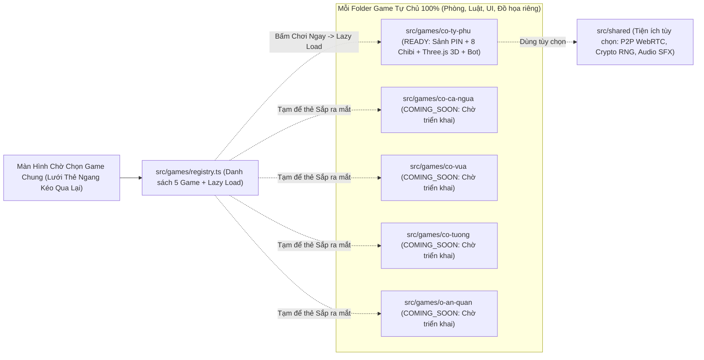

# 📁 CẤU TRÚC THƯ MỤC ĐA GAME & SẢNH CHỌN GAME LƯỚI NGANG

> **Tài liệu số 03** — Tiếp nối [01_GAME_CO_TY_PHU.md](./01_GAME_CO_TY_PHU.md) và [02_KIEN_TRUC_CONG_NGHE.md](./02_KIEN_TRUC_CONG_NGHE.md)  
> **Triết lý kiến trúc**: **Dùng chung DUY NHẤT Màn Hình Chờ Chọn Game Ngoài Cùng** (lưới ngang kéo qua lại được). Bên trong mỗi thư mục game tự chủ 100% từ luật chơi, phòng chơi, giao diện đến đồ họa — 100% Thuần Frontend, 0 Database, deploy 1 click lên **Vercel / Render Static Site**.

---

## I. NGUYÊN TẮC TỔ CHỨC: "1 SẢNH CHỌN GAME CHUNG — MỖI GAME 1 THẾ GIỚI RIÊNG"

Khác với cách ép mọi game dùng chung 1 sảnh phòng hay 1 bộ nhân vật, thực tế các game bạn dự định làm rất khác nhau:
- **Cờ Tỷ Phú Việt Nam 3D**: `2–6` người chơi, cần 8 nhân vật Chibi, bản đồ 52 ô 3D (`14×14`), 32 thẻ bài, Đấu giá Bến xe.
- **Cờ Cá Ngựa**: `2–4` người chơi, dùng quân ngựa 4 màu.
- **Cờ Vua & Cờ Tướng**: `2` người chơi đối kháng, dùng bàn lưới & quân cờ riêng.
- **Ô Ăn Quan**: `2` người chơi dân gian, dùng ô hố gỗ và viên sỏi/quan.

Vì vậy, kiến trúc gọn và thoáng nhất là:

1. **Thứ duy nhất dùng chung bắt buộc là Sảnh Chọn Game ngoài cùng (`src/hub/`)**:
   - Mở web lên là gặp ngay **Màn hình Chọn Game dạng lưới thẻ ngang kéo qua lại được (*Horizontal Swipeable Carousel*)**.
   - Khung thẻ ngang hiển thị sẵn **5 tựa game**: **Cờ Tỷ Phú 3D** *(Chơi ngay)* cùng 4 game đang để chờ **Cờ Cá Ngựa, Cờ Vua, Cờ Tướng, Ô Ăn Quan** *(nhãn `Sắp ra mắt` — tạm chưa code logic)*.
2. **Mỗi game 1 thư mục hoàn toàn độc lập (`src/games/<ma-game>/`)**:
   - Bấm vào game nào → chuyển thẳng vào màn hình riêng của folder game đó (nhận đúng 1 hàm `onExitToHub` để lúc nào thích thì thoát ra sảnh chọn game khác).
   - Bên trong mỗi game **tự do quyết định mọi thứ**: tự làm màn hình tạo phòng/chơi với Bot/Pass & Play kiểu riêng của mình, tự vẽ 2D Canvas hoặc Three.js 3D, tự quản lý state & hình ảnh riêng.
   - **Cấm import chéo giữa các folder game**: Sửa hay xóa 1 game không bao giờ làm hỏng bất kỳ game nào khác.
3. **`src/shared/` chỉ là Hộp Công Cụ Tùy Chọn (*Opt-in Helpers*)**:
   - Chứa các tiện ích thuần kỹ thuật (hàm WebRTC P2P nối máy bằng mã PIN, Google STUN / Public TURN, hàm random Web Crypto, Web Audio SFX, helper lưu `localStorage`). Game nào cần chơi online hay âm thanh thì gọi ké cho nhanh, **không hề bị ép buộc**.



---

## II. THIẾT KẾ MÀN HÌNH CHỌN GAME LƯỚI NGANG & PHONG CÁCH UIVERSE (`src/hub/`)

Giao diện sảnh ngoài giữ nguyên nền **Bàn Gỗ Nắng Ấm (`Warm Wood`)**, **không hiển thị avatar nhân vật** ở góc phải — kết hợp phong cách nút bấm 3D & màu sắc từ **UIverse (`uiverse.io`)** ([hub_wood_uiverse.png](./mockups/hub_wood_uiverse.png)):
- **Góc trên trái & góc trên phải gọn gàng**: Cụm logo `BOARD GAME VIỆT NAM` kèm thanh nhấn cầu vồng; góc phải có **nút Loa 3D** và **Cụm 4 ô đổi màu nền (`Theme Switcher`)** *(bản đầu **v1.0 chỉ làm chính thức 1 theme `Gỗ Nắng Ấm`** đúng mockup; 3 màu phụ bổ sung sau bằng gradient CSS ở Giai đoạn 2)*.
- **Thẻ game viền Gradient Neon + Kính mờ + Nút 3D nhấn lún**: Mỗi thẻ phối 1 dải màu riêng (*Ngọc Lục Bảo – Cyan – Vàng* + nút 3D **`▶ CHƠI NGAY`** cho Cờ Tỷ Phú 3D; *Cam San Hô – Hổ Phách* cho Cờ Cá Ngựa; *Xanh Da Trời – Chàm* cho Cờ Vua; *Đỏ Ruby – Hồng Đào* cho Cờ Tướng; *Ngọc Bích – Vàng Chanh* cho Ô Ăn Quan).

- **Bố cục lưới ngang kéo qua lại được (*Horizontal Scroll Snap Carousel*)**:
  - **Trên Desktop / Laptop**: Thẻ game xếp thành dải ngang lớn ngay giữa màn hình; hỗ trợ **giữ chuột kéo ngang**, lăn con lăn chuột (`Shift + Wheel` / vuốt trackpad ngang), hoặc bấm 2 nút mũi tên **`◄` / `►`** hai bên. Thẻ kế tiếp hơi ló nhẹ bên mép phải kèm thanh chấm vị trí bên dưới để người dùng nhìn là biết ngay có thể kéo ngang xem tiếp.
  - **Trên Mobile / Tablet**: Vuốt chạm ngang mượt tự nhiên (`scroll-snap-type: x mandatory`, `scroll-snap-align: center`), tự hít từng thẻ vào giữa màn hình.
- **Hiển thị 5 thẻ game trong giai đoạn đầu**:
  1. **Cờ Tỷ Phú Việt Nam 3D** *(Trạng thái: `READY`)* — Nổi bật hơn một chút với viền sáng, nút **`CHƠI NGAY`**, hiển thị `2–6 Người · 3D · 52 Ô`.
  2. **Cờ Cá Ngựa** *(Trạng thái: `COMING_SOON`)* — Badge **`Sắp ra mắt`**, mô tả `2–4 Người · Dân gian`.
  3. **Cờ Vua** *(Trạng thái: `COMING_SOON`)* — Badge **`Sắp ra mắt`**, mô tả `2 Người · Trí tuệ`.
  4. **Cờ Tướng** *(Trạng thái: `COMING_SOON`)* — Badge **`Sắp ra mắt`**, mô tả `2 Người · Cổ điển`.
  5. **Ô Ăn Quan** *(Trạng thái: `COMING_SOON`)* — Badge **`Sắp ra mắt`**, mô tả `2 Người · Dân gian Việt`.
  - *(Khi bấm vào 4 thẻ `COMING_SOON`, màn hình không báo lỗi mà bật nhẹ một pop-up thân thiện: "Tựa game đang được phát triển — Sẽ sớm ra mắt!").*

---

## III. CÂY THƯ MỤC CHUẨN CỦA TOÀN DỰ ÁN (`e:\Board_game\`)

Mỗi folder trong `src/games/` tự ôm trọn cả sảnh vào game, luật chơi, UI và hình ảnh riêng của mình:

```text
e:\Board_game\
├── docs\                                      # Tài liệu thiết kế chung & game đầu tiên
│   ├── 01_GAME_CO_TY_PHU.md                   # ✅ Luật chơi Cờ Tỷ Phú 52 ô (14x14)
│   ├── 02_KIEN_TRUC_CONG_NGHE.md              # ✅ Tech stack thuần Frontend (Vercel / Render Static)
│   ├── 03_CAU_TRUC_THU_MUC_VA_MO_RONG.md      # ✅ Tài liệu này: Sảnh ngoài + Mỗi game 1 folder tự chủ
│   └── mockups\
│       ├── web_board_3d_enlarged.png          # ✅ Mockup bàn cờ Cờ Tỷ Phú 3D (bỏ đế, fullscreen)
│       └── hub_wood_uiverse.png               # ✅ Sảnh ngoài Bàn Gỗ Nắng Ấm × UIverse 3D (bản chốt)
│
├── src\
│   ├── hub\                                   # 🏠 PHẦN DUY NHẤT DÙNG CHUNG: MÀN HÌNH CHỌN GAME
│   │   ├── assets\bg_warm_wood.webp           # Ảnh nền Bàn Gỗ Nắng Ấm sạch cho Sảnh Ngoài
│   │   ├── HubScreen.tsx                      # Nền Gỗ Nắng Ấm UIverse, nút Loa & Theme Switcher (không avatar)
│   │   ├── themes.ts                          # v1.0: Warm Wood chính (3 theme CSS phụ bật ở Giai đoạn 2)
│   │   ├── components\                        # HorizontalGameShelf, GameCard, DiceLogoBadge, ThemeSwitcherDock, ComingSoonModal
│   │
│   ├── shared\                                # 🧰 CÔNG CỤ KỸ THUẬT TÙY CHỌN (AI CẦN THÌ GỌI, KHÔNG ÉP)
│   │   ├── types\gameEntry.ts                 # Hợp đồng tối giản IGameEntry (chỉ cần id, title, status, loader)
│   │   ├── network\                           # Helper WebRTC P2P (dành cho Giai đoạn 2: Online Mã PIN)
│   │   ├── crypto\random.ts                   # cryptoRandomInt(), cryptoShuffle()
│   │   ├── audio\soundEngine.ts               # Web Audio SFX cơ bản + Mute toàn cục
│   │   └── storage\local.ts                   # Đọc/ghi localStorage & lưu ván dở trên thiết bị (0 DB)
│   │
│   ├── games\                                 # 🎮 MỖI GAME LÀ 1 THƯ MỤC RIÊNG BIỆT TỰ QUẢN LÝ 100% (KỂ CẢ ẢNH)
│   │   ├── registry.ts                        # Khai báo danh sách 5 game cho Sảnh Ngoài hiển thị
│   │   │
│   │   ├── co-ty-phu\                         # 🎲 1. CỜ TỶ PHÚ VIỆT NAM 3D (LÀM TRƯỚC)
│   │   │   ├── assets\                        # Ảnh bìa cover.webp + 8 nhân vật Chibi & avatars đặt gọn ngay trong game
│   │   │   ├── index.tsx                      # Entry nhận { onExitToHub } — tự điều phối Lobby -> Ván đấu
│   │   │   ├── lobby\                         # v1.0: 1 màn chọn 2–6 tụ (gạt Người / Máy Bot) + 8 nhân vật (PIN ở GĐ2)
│   │   │   ├── data\                          # 52 ô chuẩn 14x14, mapRandomizer giữ 22 ô khung, 32 thẻ Cơ Hội / Khí Vận
│   │   │   ├── engine\                        # Pure FSM (Đấu giá, Nhà tù 3 lượt, Bán nhà, 3 điều kiện thắng)
│   │   │   ├── ai\                            # Smart Bot riêng của Cờ Tỷ Phú
│   │   │   ├── scene\                         # Three.js Bàn Gỗ Nắng Ấm, Standee không đế, Texture Atlas 52 ô
│   │   │   ├── ui\                            # HUD 4 góc Desktop / Dock Mobile / Tile Popover
│   │   │   └── __tests__\                     # Unit test riêng của Cờ Tỷ Phú (Vitest)
│   │   │
│   │   ├── co-ca-ngua\                        # 🐎 2. CỜ CÁ NGỰA (TẠM ĐỂ CHỜ — CHƯA CODE)
│   │   │   ├── assets\cover.webp              # Ảnh bìa riêng nằm trong folder game
│   │   │   └── README.md
│   │   │
│   │   ├── co-vua\                            # ♟️ 3. CỜ VUA (TẠM ĐỂ CHỜ — CHƯA CODE)
│   │   │   ├── assets\cover.webp
│   │   │   └── README.md
│   │   │
│   │   ├── co-tuong\                          # 🏮 4. CỜ TƯỚNG (TẠM ĐỂ CHỜ — CHƯA CODE)
│   │   │   ├── assets\cover.webp
│   │   │   └── README.md
│   │   │
│   │   └── o-an-quan\                         # 🪨 5. Ô ĂN QUAN (TẠM ĐỂ CHỜ — CHƯA CODE)
│   │       ├── assets\cover.webp
│   │       └── README.md
│   │
│   ├── App.tsx                                # Giữ state đơn giản: đang ở 'hub' hay đang mở gameId nào
│   ├── main.tsx
│   └── index.css
│
├── index.html
├── package.json                               # 1 file quản lý thư viện cho toàn Web Hub
├── vercel.json                                # SPA fallback về index.html cho Vercel
└── vite.config.ts                             # Lazy-load từng folder game (vào Hub chưa phải tải Three.js)
```

> **Ghi chú tổ chức tài nguyên**: Toàn bộ ảnh bìa và 16 ảnh nhân vật đã được đưa thẳng vào bên trong `src/hub/assets/` và `src/games/<ten-game>/assets/` (xóa bỏ thư mục `assets/` rời bên ngoài), đảm bảo mỗi thư mục game tự chủ 100% và được Vite đóng gói tối ưu theo từng chunk.

---

## IV. HỢP ĐỒNG TỐI GIẢN CHO TỪNG FOLDER GAME (`IGameEntry`)

Để Sảnh Ngoài hoàn toàn **không can thiệp** vào cách từng game tổ chức phòng hay luật chơi, hợp đồng giữa Sảnh (`src/hub/`) và từng folder game (`src/games/*`) chỉ vỏn vẹn vài dòng trong `src/shared/types/gameEntry.ts`:

```ts
export type GameStatus = 'READY' | 'COMING_SOON';

export interface GameComponentProps {
  /** Gọi hàm này khi người chơi bấm nút "Về Chọn Game" bên trong game */
  onExitToHub: () => void;
}

export interface IGameEntry {
  id: 'co-ty-phu' | 'co-ca-ngua' | 'co-vua' | 'co-tuong' | 'o-an-quan';
  title: string;
  subtitle: string;
  playersBadge: string; // VD: "2-6 Người", "2-4 Người", "2 Người"
  tags: string[];       // VD: ["3D", "Online PIN", "Bot AI"]
  thumbnailUrl: string;
  status: GameStatus;
  /** Chỉ cần có khi status === 'READY'; dùng dynamic import để tải siêu nhẹ */
  loader?: () => Promise<{ default: React.ComponentType<GameComponentProps> }>;
}
```

### Danh sách khai báo sẵn 5 Game tại `src/games/registry.ts`

```ts
export const GAME_CATALOG: IGameEntry[] = [
  {
    id: 'co-ty-phu',
    title: 'Cờ Tỷ Phú Việt Nam 3D',
    subtitle: '52 Ô 14×14 · Đấu giá Bến xe · 3 điều kiện thắng',
    playersBadge: '2–6 Người',
    tags: ['3D', 'Online PIN', 'Đấu Bot', 'Chung 1 Máy'],
    thumbnailUrl: '/assets/hub/thumb_co_ty_phu.png',
    status: 'READY',
    loader: () => import('./co-ty-phu'),
  },
  {
    id: 'co-ca-ngua',
    title: 'Cờ Cá Ngựa',
    subtitle: 'Đổ xúc xắc tung vó về chuồng 4 sắc màu',
    playersBadge: '2–4 Người',
    tags: ['Dân gian', 'Sắp ra mắt'],
    thumbnailUrl: '/assets/hub/thumb_co_ca_ngua.png',
    status: 'COMING_SOON',
  },
  {
    id: 'co-vua',
    title: 'Cờ Vua',
    subtitle: 'Đấu trí 64 ô đen trắng cổ điển',
    playersBadge: '2 Người',
    tags: ['Trí tuệ', 'Sắp ra mắt'],
    thumbnailUrl: '/assets/hub/thumb_co_vua.png',
    status: 'COMING_SOON',
  },
  {
    id: 'co-tuong',
    title: 'Cờ Tướng',
    subtitle: 'Bàn cờ gỗ 9×10 truyền thống Á Đông',
    playersBadge: '2 Người',
    tags: ['Cổ điển', 'Sắp ra mắt'],
    thumbnailUrl: '/assets/hub/thumb_co_tuong.png',
    status: 'COMING_SOON',
  },
  {
    id: 'o-an-quan',
    title: 'Ô Ăn Quan',
    subtitle: 'Trò chơi rải sỏi dân gian tuổi thơ Việt Nam',
    playersBadge: '2 Người',
    tags: ['Dân gian Việt', 'Sắp ra mắt'],
    thumbnailUrl: '/assets/hub/thumb_o_an_quan.png',
    status: 'COMING_SOON',
  },
];
```

---

## V. QUY TRÌNH MỞ KHÓA 1 GAME TỪ "SẮP RA MẮT" SANG "CHƠI NGAY"

Sau này khi làm xong *Cờ Tỷ Phú 3D*, bất cứ lúc nào bạn muốn bắt đầu code 1 trong 4 game đang để chờ (*Cờ Cá Ngựa, Cờ Vua, Cờ Tướng, Ô Ăn Quan*):

1. Mở đúng thư mục trống tương ứng trong `src/games/<ten-game>/` (không cần đụng gì tới `src/games/co-ty-phu/`).
2. Tự tạo giao diện sảnh, engine luật và màn chơi riêng bên trong thư mục đó, export 1 component gốc nhận `{ onExitToHub }` tại `src/games/<ten-game>/index.tsx`.
3. Mở `src/games/registry.ts`, đổi `status: 'COMING_SOON'` → `'READY'` và gắn `loader: () => import('./<ten-game>')`.
4. Chạy `npm run build` rồi đẩy lên **Vercel** hoặc **Render Static Site** (kèm rule rewrite `/* → /index.html` để F5 không lỗi 404).

---

## VI. TỔNG KẾT LỘ TRÌNH & BƯỚC TIẾP THEO

| Tài Liệu | Trạng Thái | Nội Dung Đã Chốt |
| :--- | :---: | :--- |
| [01_GAME_CO_TY_PHU.md](./01_GAME_CO_TY_PHU.md) | ✅ | Luật chơi chi tiết game đầu tiên: Cờ Tỷ Phú Việt Nam 52 ô (`14×14`) |
| [02_KIEN_TRUC_CONG_NGHE.md](./02_KIEN_TRUC_CONG_NGHE.md) | ✅ | Thuần Frontend 100% (Vite + React + Three.js, 0 Backend, 0 Database, Vercel/Render Ready) |
| [03_CAU_TRUC_THU_MUC_VA_MO_RONG.md](./03_CAU_TRUC_THU_MUC_VA_MO_RONG.md) | ✅ | Chỉ dùng chung Sảnh Chọn Game lưới ngang kéo qua lại; 5 folder game độc lập tự chủ |
| [hub_wood_uiverse.png](./mockups/hub_wood_uiverse.png) | ✅ | Ảnh giao diện Sảnh Ngoài đã chốt *(Bàn Gỗ Nắng Ấm × nút 3D & màu UIverse)* |

> **Bước kế tiếp**: Sau khi bạn duyệt ảnh giao diện Sảnh Ngoài và cấu trúc 5 folder này, mình sẽ tiến hành **khởi tạo dự án Vite + React + TypeScript**, dựng **Sảnh Chọn Game lưới ngang** trước, rồi bắt tay vào **Folder Game 01 (`src/games/co-ty-phu/`)**!
