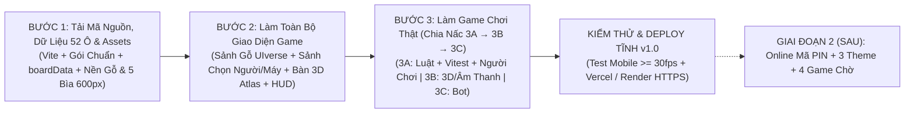

# 🚀 KẾ HOẠCH TRIỂN KHAI THEO 3 BƯỚC CHÍNH & KIỂM THỬ DEPLOY (VERCEL / RENDER STATIC)

> **Tài liệu số 04** — Lộ trình thực thi thực tế từ bộ thiết kế ([01](./01_GAME_CO_TY_PHU.md) · [02](./02_KIEN_TRUC_CONG_NGHE.md) · [03](./03_CAU_TRUC_THU_MUC_VA_MO_RONG.md)):  
> **Phạm vi Bản v1.0**: **1 Theme chính Bàn Gỗ Nắng Ấm × UIverse** + **Cờ Tỷ Phú Việt Nam 3D** *(gom gọn 1 chế độ chơi trên thiết bị: **chọn `2–6` vị trí, từng vị trí gạt `Người thật` hoặc `Máy (Bot)`** — hỗ trợ cả 1 mình đấu Máy, nhiều bạn chung máy, hay người + máy xen kẽ)*.  
> **Giai đoạn 2 (Mở rộng sau)**: *Chơi Online Mã PIN P2P*, *3 Theme CSS phụ*, và *4 game đang chờ*.

---

## I. BƯỚC 1 — TẢI MÃ NGUỒN, KHÓA PHIÊN BẢN CODE, DỮ LIỆU 52 Ô & TÀI NGUYÊN SẢNH

Mục tiêu của Bước 1 là chuẩn bị đủ **bộ khung code, khóa phiên bản bằng `package-lock.json`, dữ liệu 52 ô chuẩn cho Bước 2 vẽ bàn cờ, và đưa toàn bộ ảnh sạch vào thẳng mã nguồn từng game trong `src/`**.

### 1. Kiểm tra công cụ & Tạo khung Vite + React + TypeScript
- **Yêu cầu máy**: `Node.js >= 20 LTS` và `npm >= 10` (100% thuần Client, **0 Backend, 0 Database**).
- **Khởi tạo mã nguồn**: Tạo dự án Vite + React + TypeScript tại `e:\Board_game\` (giữ nguyên `docs/`), bật TypeScript strict + alias `@/` trỏ vào `src/`.

### 2. Danh sách thư viện cài đặt ở v1.0 *(khóa phiên bản tự động bằng `package-lock.json`)*
| Nhóm | Thư Viện Cài Đặt (`npm install`) | Vai Trò Trong v1.0 |
| :--- | :--- | :--- |
| **Giao diện & CSS** | `react`, `react-dom`, `tailwindcss`, `lucide-react` | Dựng Sảnh Ngoài UIverse, Sảnh chế độ, Modal & HUD PC/Mobile |
| **Đồ họa 3D** | `three`, `@types/three` | Dựng Bàn Gỗ 3D, bàn cờ `14×14`, Texture Atlas 52 ô, xúc xắc, nhà & 8 nhân vật không đế |
| **Quản lý State** | `zustand` | Quản lý trạng thái Sảnh, Âm thanh, ván chơi & lưu tiến độ tạm |
| **Kiểm thử tự động** | `vitest`, `@vitest/ui` | Chạy unit test toàn bộ luật chơi File 01 ngay khi code Bước 3A |

*(Gói `peerjs` / `trystero` cho mạng P2P sẽ cài ở **Giai đoạn 2** để giữ bundle v1.0 nhẹ nhất có thể).*

### 3. Dữ liệu & Tài nguyên bắt buộc hoàn thành ngay trong Bước 1
1. **Dựng cây thư mục chuẩn File 03**: `src/hub/`, `src/shared/` *(crypto, audio, localStorage)*, `src/games/registry.ts`, `src/games/co-ty-phu/` *(data, engine, ai, scene, ui, lobby)*, cùng 4 folder chờ (`o-an-quan`, `co-ca-ngua`, `co-vua`, `co-tuong`).
2. **Tạo sẵn dữ liệu lõi cho Bước 2 vẽ đúng bàn cờ**: Code trước `src/games/co-ty-phu/engine/types.ts` và `src/games/co-ty-phu/data/boardData.ts` khớp 100% **Bảng 52 Ô Bản Đồ Mặc Định (`0 → 51`)** trong [File 01](./01_GAME_CO_TY_PHU.md).
3. **Đưa trọn bộ ảnh vào trực tiếp thư mục mã nguồn tương ứng (và xóa thư mục `assets/` rời bên ngoài)**:
   - Đưa **16 file nhân vật không đế (`360×512`) và avatar (`256×256`)** (tổng **`1,731,848 bytes`, ~`1.65 MiB`**) vào `src/games/co-ty-phu/assets/characters/` và xóa thư mục `assets/` rời ngoài gốc dự án.
   - Đặt ảnh nền gỗ sạch `bg_warm_wood.webp` vào `src/hub/assets/` và đặt **5 ảnh bìa `cover.webp` sắc nét** vào thẳng `src/games/<ten-game>/assets/` *(đã vẽ lại Cờ Cá Ngựa 4 màu to cổ, Cờ Vua Đen–Trắng, Ô Ăn Quan nền đất quê cổ & Cờ Tướng chữ gỗ chuẩn)*.

> **Nghiệm thu Bước 1**: `npm run dev` lên mượt, `npm run build` sạch lỗi TypeScript, kiểm tra đủ `16` ảnh Chibi + `1` nền gỗ + `5` ảnh bìa nằm gọn trong `src/` và file `boardData.ts` đủ `52` ô.

---

## II. BƯỚC 2 — LÀM TOÀN BỘ GIAO DIỆN GAME (V1.0 GỖ NẮNG ẤM × UIVERSE & BÀN CỜ 3D)

Hoàn thiện **100% giao diện & chuyển màn hình** trên PC (`16:9`) và Mobile dọc (`390×844`) trước khi nối luật phức tạp.

### 1. Sảnh Chọn Game Ngoài Cùng (`src/hub/` — đúng [hub_wood_uiverse.png](./mockups/hub_wood_uiverse.png))
- **1 Theme chính hoàn thiện ở v1.0**: Nền **Bàn Gỗ Nắng Ấm** bóng lá dừa (`bg_warm_wood.png`), không có avatar nam góc phải. Góc phải giữ **Nút Loa 3D** và **Nút Chọn Màu** *(hiển thị theme Gỗ Nắng Ấm đang bật, 3 ô còn lại gắn nhãn `Sắp mở` để mở rộng bằng CSS ở Giai đoạn 2)*.
- **Dải Thẻ Ngang UIverse (`HorizontalGameShelf`)**:
  - 5 thẻ dùng ảnh bìa `cover.webp` sắc nét trong `src/games/<id>/assets/`, viền gradient neon + nền kính mờ riêng màu từng game.
  - Nút **3D nhấn lún kiểu UIverse** (`▶ CHƠI NGAY`), badge **`SẮP RA MẮT`** 3D, nút mũi tên **`◄` / `►`**, thanh chấm chỉ báo màu, hỗ trợ kéo chuột / lăn ngang / vuốt chạm mobile (`scroll-snap`) + modal thông báo gọn khi bấm 4 game chờ.

### 2. Sảnh Phòng Chơi & Bàn Cờ 3D Cờ Tỷ Phú (`src/games/co-ty-phu/`)
- **Sảnh Thiết Lập Ván Gọn 1 Màn (`lobby/`)**:
  - Gom thành **1 bảng chọn duy nhất cho v1.0**: chọn **số tụ `2–6` người/máy**, tại mỗi tụ gạt **`Người thật` / `Máy (Bot)`**, đặt tên & chọn từ **8 Nhân vật Chibi Việt Nam** *(chơi 1 mình với Bot, nhiều người chung 1 máy, hay người + máy xen kẽ đều chỉ cần 1 màn hình này; nút **Chơi Online Mã PIN** giữ ở thẻ `Sắp mở — Giai đoạn 2`)*.
  - Chọn **1 hoặc 2 Xúc Xắc**, chọn **Bản Đồ Mặc Định** hoặc **Bản Đồ Ngẫu Nhiên** *(giữ nguyên 22 ô khung, chỉ xáo trộn 30 ô Đất)*, kèm nút **`Tiếp tục ván dở`** nếu có dữ liệu trong `localStorage` và nút **`Quay lại Sảnh Game`**.
- **Sân Khấu 3D (`scene/`) & HUD Nổi (`ui/` — lấy cảm hứng bố cục từ [web_board_3d_enlarged.png](./mockups/web_board_3d_enlarged.png))**:
  - Bàn Gỗ + bàn cờ `14×14` đọc tên & giá thật từ **`boardData.ts` (52 ô tiếng Việt đầy đủ dấu)**, chính giữa đặt Bản đồ Việt Nam + 2 chồng bài 3D (`Cơ Hội`, `Khí Vận`).
  - **Tối ưu GPU bằng `TileTextureAtlas`**: Gom 52 ô vào **1–2 Texture Atlas** (`2048×2048` trên PC, hạ độ phân giải phù hợp trên Mobile) để tiết kiệm VRAM, giữ **≥ 30fps ổn định trên điện thoại tầm trung** không crash Safari/Chrome.
  - **3 Góc Nhìn Camera** (`Góc rộng`, `Cổ điển 45°`, `Nhìn thẳng 2.5D`) + HUD 4 góc gọn + đủ bộ Modal xem trước (Mua đất, Nâng nhà, Rút thẻ, Đấu giá, Sân bay, Bán tài sản, Bảng Vinh Danh).

> **Nghiệm thu Bước 2**: Đi xuyên suốt Sảnh Ngoài UIverse → Chọn chế độ → Bàn Cờ 3D đọc rõ 52 ô tiếng Việt thật (từ `boardData.ts`) và HUD responsive mượt, **chạy thử trên điện thoại hoặc giả lập Mobile đạt ≥ 30fps**.

---

## III. BƯỚC 3 — LÀM GAME CHƠI THẬT, HIỆU ỨNG, ÂM THANH, XÚC XẮC & NHÂN VẬT (CHIA 3 NẤC NHỎ)

Thay vì làm một lèo quá nặng, Bước 3 tách thành **3 nấc cuốn chiếu (`3A → 3B → 3C`)**, xong nấc nào chơi thử & kiểm tra ngay nấc đó, **khớp 100% luật [01_GAME_CO_TY_PHU.md](./01_GAME_CO_TY_PHU.md)**.

### Nấc 3A — Lõi Luật Chơi Pure TS + Unit Test Vitest + Chạy Ván Thật Cho Các Tụ Người Chơi
1. **Code lõi `engine/` thuần TypeScript (tách 0% React/Three.js)** theo đúng File 01:
   - `mapGenerator.ts`: Bản đồ Mặc định & Bản đồ Ngẫu nhiên **giữ cố định 22 ô khung đặc biệt** *(4 Ô Góc `0,13,26,39`, 4 Bến Xe `5,18,31,44`, 2 Sân Bay `7,33`, 2 Thủy Điện `20,46`, 4 Cơ Hội, 4 Khí Vận, Di Sản `24`, Thuế `50`)*, **chỉ xáo trộn 30 Ô Đất Địa Danh** giữa `30` slot đất (không đặt 2 ô giá vàng `≥ 7M` liền kề).
   - **Di chuyển & Khởi Hành**: Tiến ngang qua ô `0` nhận `+3.000.000 đ`; **đi lùi qua ô `0` KHÔNG nhận `3M`, nhưng lùi xong rồi lượt sau đi tiến qua `0` VẪN nhận đủ `3M`**.
   - **Kinh tế, 32 thẻ & ngoại lệ đa người**: Tiền thuê 5 cấp & $\times 2$ đủ bộ màu; Thuế BĐS (`200K/nhà`, `1M/Biệt Thự`, tối thiểu `50K`); Thủy điện (`×100K` / `×250K`); thực thi đủ 32 thẻ Cơ Hội / Khí Vận *(với thẻ *Khách Sạn 5 Sao* hoặc *Mừng Cưới Bạn Thân* liên quan nhiều người cùng lúc, xử lý tuần tự từng người theo `turnOrder` để bật Bán tài sản/Phá sản gọn gàng, không kẹt FSM)*.
   - **Đấu giá Bến xe, Sân bay, Nhà Tù & 3 Điều kiện thắng**:
     - Đấu giá `+200K` nộp bù chênh lệch, hoàn `100%` cọc khi Bỏ quyền/Bị loại, chốt thu `Giá Chốt / 2`.
     - Sân bay chỉ bay tới 1 trong 30 ô Đất Địa Danh công khai (không qua Khởi Hành) và đổi điểm đến ngay sau chuyến bay.
     - Nhà Tù: Thăm `500K`, bảo lãnh `1M`, tối đa 3 lượt, **phong tỏa 100% thu tiền thuê khi đang ngồi tù**.
     - Bán nhà `50%` từng cấp rồi mới được bán đất `50%`; kiểm tra ngay **3 Điều kiện Thắng** (`9 ô mua được trên 1 cạnh`, `4 Bến Xe`, `Sinh Tồn cuối cùng`).
2. **Viết & Chạy `Vitest` song song ngay tại 3A (`src/games/co-ty-phu/__tests__/`)**:
   - Đổ đôi 3 lần vào Tù; chủ đất ở Tù miễn `100%` thuê.
   - Lùi 3 ô qua Khởi Hành không cộng `3M`, lượt sau đi qua lại vẫn cộng `3M`.
   - *Khách Sạn 5 Sao* khi 2 đối thủ cùng thiếu `300K`; người giữ cọc đấu giá bị Phá sản ở ô khác.
   - Bản đồ Ngẫu nhiên luôn giữ nguyên tọa độ 22 ô khung & `9` ô mua được mỗi cạnh.
   - Chạy xanh hết bộ test `npx vitest run` rồi ghép thẳng vào UI **cho các tụ `Người thật` chơi trọn ván trên 1 máy** *(nếu có từ 2 người thật trở lên tự hiện banner `Đến lượt [Tên]`)* + tự lưu snapshot vào `localStorage` để lỡ tắt tab/F5 vẫn chơi tiếp được.

### Nấc 3B — Hiệu Ứng Xúc Xắc 3D, 8 Nhân Vật Không Đế, Máy Bay, Nhà Đất & Âm Thanh Web Audio
- **Xúc xắc 3D**: 1 hoặc 2 viên xúc xắc tung nảy từ khay giữa bàn dừng đúng số `crypto.getRandomValues()`, hiện hiệu ứng **`ĐỔ ĐÔI! ĐI TIẾP`**.
- **8 Nhân vật Không Đế (`TokenSprite3D`)**: Standee 2 mặt đứng thẳng sát mặt gỗ (`đế = 0`) có bóng đổ tròn, nhảy nhún cong từng bước tiến (hoặc đi lùi với thẻ *Lùi 3 ô*), bay vào song sắt khi đi Tù, tự tách slot đẹp khi `2–6` người đứng chung ô, cộng vòng sáng mảnh dưới chân người đang tới lượt.
- **Nhà Đất, Thẻ Bài & Atlas Động**: Nhà Xanh (`1–4`) / Khách Sạn Đỏ nảy *pop-up* khi nâng cấp; mô hình máy bay chở quân cờ bay công khai ở ô Sân Bay; số tiền `+3.0M` / `-1.2M` bay nổi trên đầu; lật 3D 32 thẻ bài; cập nhật vùng `rect` trên `TileTextureAtlas` tức thì khi ô đổi chủ/giá cọc/điểm bay; pháo hoa chiến thắng.
- **Hệ Thống Âm Thanh (`Web Audio API` — không nặng file MP3)**: Tiếng lắc & gõ xúc xắc, tiếng bước nhảy, tiếng lật thẻ, chuông thu/trả tiền, búa xây nhà, động cơ máy bay, còi & khóa Nhà Tù, kèn Vinh Danh (đồng bộ nút tắt/mở Loa trên HUD & Sảnh).

### Nấc 3C — Đấu Với Máy Thông Minh (`SmartAI Bot`)
- Hoàn thiện mô-đun `src/games/co-ty-phu/ai/`: giữ quỹ an toàn `SafeReserve`, ưu tiên mua chặn bộ 3 màu, tính trần đấu giá theo phần bù chênh lệch, bật cảnh giác `AntiWinGuard` khi đối thủ sắp đủ `7/9` ô 1 cạnh hoặc `2–3/4` Bến xe, chiến thuật ra tù sớm/muộn.
- Thử nghiệm thực tế **1 Người vs 5 Bot** chạy trọn vẹn từ đầu tới cuối trận không kẹt lượt.

---

## IV. BƯỚC 4 — KIỂM THỬ TOÀN DIỆN v1.0 & DEPLOY LÊN VERCEL / RENDER STATIC

1. **Checklist Kiểm Thử Thực Chiến Trước Phát Hành v1.0**:
   - Chạy `npx vitest run` xanh 100% toàn bộ bộ test luật chơi File 01.
   - Kiểm tra **thoát Game 01 → về Sảnh Ngoài → vào lại 5 lần liên tiếp**: dọn `.dispose()` Geometry/Material/Texture & Atlas triệt để, không tăng bộ nhớ WebGL, không đúp `<canvas>`.
   - Kiểm tra **lưu & khôi phục ván dở `localStorage`**: tắt trình duyệt giữa chừng ở bất kỳ tổ hợp Người/Máy nào rồi mở lại đúng bàn đấu đang dở.
   - Kiểm tra hiển thị thật trên **Laptop (`1366×768` / `1920×1080`)** và **Mobile (`390×844`)** (độ mượt `>= 30fps`, chạm `Raycaster` chọn ô chuẩn, không tràn chữ tiếng Việt).
2. **Đưa Bản v1.0 Lên Web Miễn Phí (0 Backend, 0 Database)**:
   - **Vercel**: Tạo `vercel.json` ở gốc `e:\Board_game\vercel.json` với `rewrites: [{ "source": "/(.*)", "destination": "/index.html" }]` → Deploy thẳng từ GitHub hoặc Vercel CLI.
   - **Render (Static Site — không ngủ đông)**: Chọn **Static Site** *(KHÔNG chọn Web Service)*, Build `npm install && npm run build`, Publish `dist`, Redirect/Rewrite `/* -> /index.html`.
   - Kiểm tra trực tiếp trên đường dẫn **`https://...`** thật *(Web Crypto `randomUUID`/`subtle` và WebRTC P2P ở giai đoạn 2 cần chạy trên HTTPS; `crypto.getRandomValues` chạy được ở mọi môi trường nhưng vẫn ưu tiên test kỹ trên HTTPS thật)*.

---

## V. GIAI ĐOẠN 2 — MỞ RỘNG SAU KHI BẢN v1.0 ĐÃ CHƠI MƯỢT

1. **Chơi Online Mã PIN 6 Ký Tự (WebRTC P2P)**: Cài `peerjs` + Google STUN + **tài khoản TURN miễn phí riêng** *(để xuyên NAT/4G CGNAT ổn định hơn)* + màn hình báo lỗi/Thử lại rõ ràng + Host Migration & F5 Reconnect *(không cần lưu ván dài hạn như offline; giai đoạn bạn bè chơi chung tạm tin tưởng Host sinh xúc xắc)*.
2. **Hoàn thiện 3 Theme phụ ngoài Sảnh UIverse**: Bật đủ *Bạc Hà Nhiệt Đới*, *Hoàng Hôn Pastel*, *Đêm Neon* bằng gradient CSS nhẹ.
3. **Mở khóa dần 4 Game Chờ theo độ dễ → khó**: **`o-an-quan` (Ô Ăn Quan)** → **`co-ca-ngua` (Cờ Cá Ngựa)** → **`co-vua` (Cờ Vua)** → **`co-tuong` (Cờ Tướng)**.

---

> **Trạng thái bộ tài liệu (`01` → `04`)**: Đã đồng bộ hoàn toàn tên thư mục (`scene/`), đường dẫn tài nguyên tự quản lý bên trong từng game (`src/games/<id>/assets/` & `src/games/co-ty-phu/assets/characters/`), Bảng 52 Ô Mặc Định (`0 → 51`), quy tắc lùi qua Khởi Hành, quy tắc giữ nguyên 22 ô khung khi Random Map, và phạm vi **v1.0 gom gọn 1 chế độ Người & Máy (Gỗ Nắng Ấm)** trước khi lên Online P2P.
